# Architecture of the Feature Workflow

There are three entry points: `/feature-lean`, the main mode (§2), the full `/feature` workflow, and `/feature-kit`. Most of this document describes how the full `/feature` workflow is built: who takes part, how a feature moves from request to integration, which files hold the state, and what each agent is responsible for. The behavior itself is defined by the files under `skills/feature/`. When this document and those files disagree, the files win, and each section names the file it summarizes.

Diagrams use Mermaid and render on GitHub.

## Contents

1. [Building blocks](#1-building-blocks)
2. [Entry points and modes](#2-entry-points-and-modes)
3. [Startup of a feature](#3-startup-of-a-feature)
4. [SDD Direct](#4-sdd-direct)
5. [ESDD and Hybrid](#5-esdd-and-hybrid)
6. [Intensity levels](#6-intensity-levels)
7. [Agent questions](#7-agent-questions)
8. [Review cycle](#8-review-cycle)
9. [Anti-pattern registry and quality gate](#9-anti-pattern-registry-and-quality-gate)
10. [Several features and several orchestrators](#10-several-features-and-several-orchestrators), including phased mode
11. [Responsibilities per agent](#11-responsibilities-per-agent)
12. [Artifacts and state](#12-artifacts-and-state)
13. [Design principles](#13-design-principles)

## 1. Building blocks

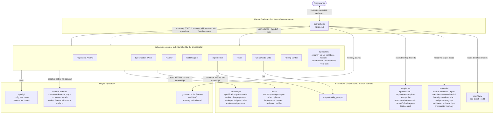

| Block | What it is | Source |
| --- | --- | --- |
| **Programmer** | Makes every consequential decision: requirements, scope, architecture, dependencies, trade-offs, acceptance, integration. | `SKILL.md` §1 |
| **Orchestrator** | The main session after `/feature`. The only party that talks to the programmer. It parses requests, creates worktrees, briefs subagents, verifies what they return, relays their questions, presents gates and records decisions. It writes no production code. | `SKILL.md` |
| **Subagents** | Claude Code built-in subagents (`Explore`, `Plan`, `general-purpose`) with a model chosen per task. Each one is pointed at its role file and never delegates further. | `SKILL.md` §4 |
| **Skill library** | Markdown files read only when a step needs them (progressive loading), plus one script. | `SKILL.md` §3 |
| **Feature worktree** | One git worktree and branch per feature. Code and artifacts travel together on that branch. | `SKILL.md` §2.3 |
| **`.quality/`** | The project's quality configuration and anti-pattern registry. It outlives features. The programmer chooses at bootstrap whether it is versioned (`<repo>/.quality/`) or local to the clone (`<git-common-dir>/quality/`). | `protocols/anti-pattern-registry.md` |
| **Git common dir** | Shared by every worktree and never committed: the orchestrator's project memory and the feature claims. | `protocols/orchestrator-memory.md`, `protocols/hierarchy.md` |

## 2. Entry points and modes

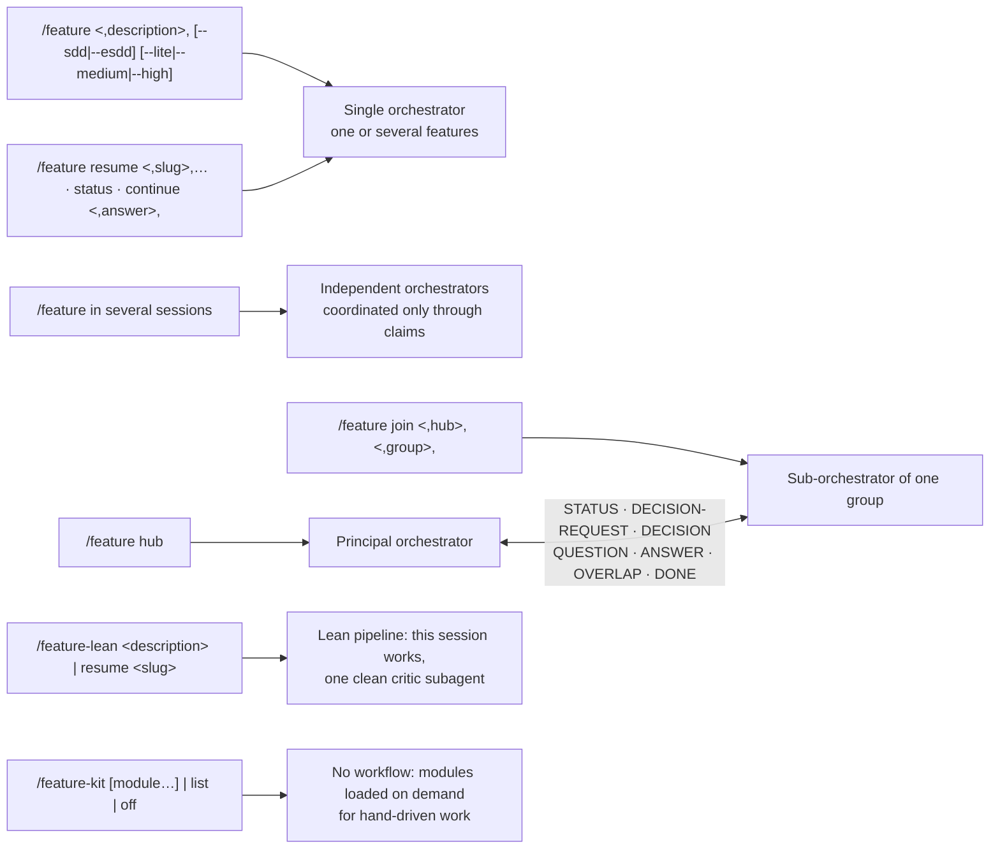

| Command | Effect |
| --- | --- |
| `/feature <description>` | A new feature is added to the portfolio. Features already in progress are never reset. |
| `/feature resume <slug>…` | Continues features from their `handoff.md`, after a freshness check. |
| `/feature status` | Board of every feature in progress, plus the ones other orchestrators claim. |
| `/feature continue <answer>` | A fresh session answers a pending gate, using `memory.md` and `decisions/` on disk. |
| `/feature hub`, `/feature join <hub> <group>` | Hierarchical mode (§10). |
| `/feature-lean <description>` | Separate skill: one session, one feature, no orchestrator relay; the only artifacts are a card and the review. Steps below. |
| `/feature-kit` | Separate skill. It exposes the roles and knowledge as modules (explore, spec, plan, decide, quality/ponytail, patterns, antipatterns, test, e2e, gate, review, card) without phases, gates, artifacts or worktrees. Only `review` launches subagents: a clean critic and, if asked, a verifier. |

**`/feature-lean` steps** (detailed in [`lean.md`](lean.md)):
1. A specification pass covers edge, error, security and worst-case behavior. Each case states what the project's nearest existing analog does with it.
2. ⛔ Gate 1: questions and approach. Options carry their security consequence and their probed worst case.
3. Code and tests: every case, a status for each testing technique, and fuzz or property tests at trust boundaries. Then the quality gate.
4. One clean critic (opus), plus the specialist audits you chose (security mandatory if Critical and matching). Each finding is checked against the code.
5. ⛔ Gate 2: every finding, each with fix · accept · change behavior.
6. ⛔ Acceptance, integration and cleanup.

All three skills have `disable-model-invocation: true`: they load only when the programmer types the command.

## 3. Startup of a feature

Source: `SKILL.md` §2.

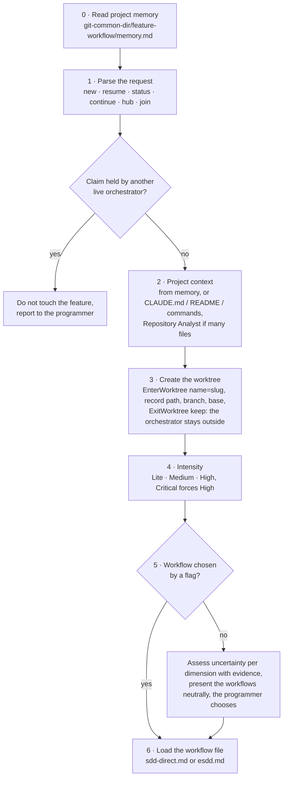

- **Uncertainty dimensions** for the workflow choice: requirement clarity, functional uncertainty, technical feasibility, architectural uncertainty, expected discoveries, need for prototypes. Feature size alone never decides.
- **Worktree failures** (not a git repository, a git error, already inside a worktree session) stop the feature and are presented to the programmer. The orchestrator never falls back to the shared checkout.

## 4. SDD Direct

For well-understood features. Source: `workflows/sdd-direct.md`. ⛔ is a human gate: it stops this feature only, and other features keep moving.

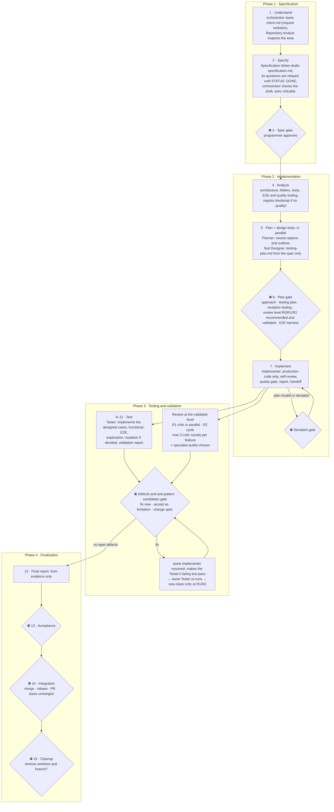

**Definition of done** (checked before acceptance):
- Spec and plan are approved.
- The scope matches, and any deviation is approved.
- Every acceptance criterion has evidence.
- E2E and every black-box technique have a status.
- The quality gate passes, or each remaining violation has a decision.
- Anti-pattern candidates were presented.
- Mutation testing and review ran as decided.
- Regressions were evaluated, and no blocking issue is hidden.

## 5. ESDD and Hybrid

For features with open requirements or technical unknowns. Source: `workflows/esdd.md`.

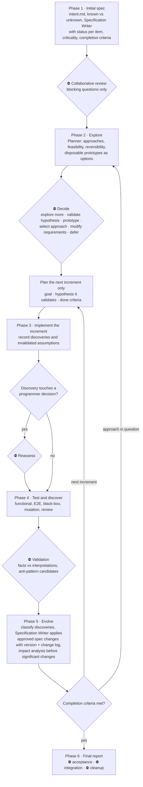

- **Statuses** for spec items and discoveries: Confirmed, Hypothesis, Under exploration, Rejected.
- **Requirement changes** are typed Added, Clarified, Modified, Replaced or Retired, and every one is approved by the programmer.
- **Prototypes** live outside production paths. They are discarded unless the programmer promotes them.
- **Hybrid:** SDD Direct for the feature as a whole, with Phases 2–5 applied only to the uncertain area.

## 6. Intensity levels

Set per feature or per group. Source: `protocols/intensity.md`.

| Aspect | Lite | Medium | High |
| --- | --- | --- | --- |
| Workflow | SDD Direct | SDD Direct, ESDD, Hybrid | SDD Direct, ESDD, Hybrid |
| Repository Analyst | no | only if the memory lacks the evidence | yes |
| Specification Writer | no: the orchestrator writes the card's spec section | yes | yes |
| Planner | no: the orchestrator writes one approach | main decision only | full solution space |
| Test Designer | no | yes, from the spec, in parallel with the Planner | yes, every technique |
| Implementer | code **and** its unit and E2E tests | production code only | same as Medium |
| Tester | no | implements and runs the designed cases, with E2E | same, plus every technique and mutation testing |
| Review (default the recommendation starts from) | R0 | R1 | R2 |
| Specialists | you choose at the spec + plan gate | you choose at the spec gate | you choose at the spec gate (mandatory ones run if Critical) |
| Mutation testing | no | asked at the plan gate | yes |
| Gates | one spec+plan gate, then acceptance | spec, plan, defects, acceptance | all |
| Artifacts | one `feature.md` card (target 500 lines) + `decisions/` | full set, with size targets (overflow goes to linked files, never cut) | full set |
| Agent questions | yes | yes | yes |

Critical features always run at High.

## 7. Agent questions

Subagents cannot talk to the programmer, so they ask through the orchestrator. Source: `protocols/agent-questions.md`.

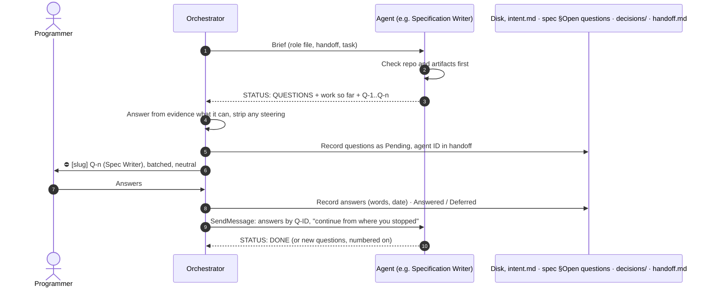

- **Blocking** questions are the ones whose answer changes the agent's output: a requirement, scope, observable behavior, a constraint, the viable approaches, or a test's expected result. The agent stops and does not guess. A question that changes the output for a valid input is always blocking, and the agent never weakens an acceptance criterion to avoid it.
- **Non-blocking** questions: the agent continues under an assumption labeled Hypothesis and lists it. The question goes to the next gate.
- **If the agent cannot be resumed** (a new session or an error), a new agent gets the same brief plus the earlier "work so far" and the answers.
- **Answers that change approved work** become a spec version bump or a decision record. Approved work never changes silently.
- **Critics and verifiers never ask:** they report ambiguity as a finding.

## 8. Review cycle

Source: `protocols/review-cycle.md`. The orchestrator **recommends** the level with evidence, and the programmer validates it. This is the one standing exception to neutrality.

| Level | What runs | Typical feature |
| --- | --- | --- |
| R0 | Quality gate and project lint only | Mechanical change, about 50 changed lines, no risk areas |
| R1 | One clean critic, in parallel with the Tester | Standard feature with new logic |
| R2 | Critic → verifier → automatic fixes → new critic on the fixes only, 3 critic rounds per feature at most | Critical, or large or complex |

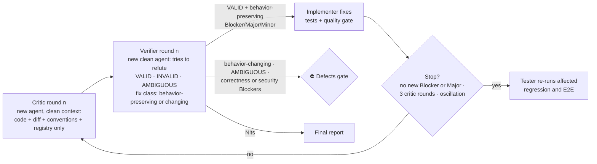

- **Review level:** the recommendation starts from the intensity default (Lite R0, Medium R1, High R2, Critical R2). A standing "accept your recommendation" covers only that default; a deviation is asked every time.
- **Automatic fixes** happen only at R2. Each one is listed at the next gate with its hunks and a revert option. The orchestrator never changes code itself (`SKILL.md` §1, principle 9).
- **Convergence:** round 1 reviews the whole diff. Later rounds review only the fixes, and report only Blocker and Major findings.
- **Clean context:** the critic and the verifier never read the spec, plan, decisions, handoffs, implementation report or earlier rounds. Each round launches a **new** critic on the whole diff from the base.
- **Round log** in `reports/review/rounds.md`. Findings that recur become anti-pattern candidates. The INVALID rate shows how noisy the critic is.
- **Why it is built this way:** self-attribution and self-preference bias in LLM evaluators, adversarial refutation, and diminishing returns after three or four repair iterations. The papers are cited in [`references.md`](references.md).

## 9. Anti-pattern registry and quality gate

Sources: `protocols/anti-pattern-registry.md`, `knowledge/code-quality.md`, `scripts/quality_gate.py`.

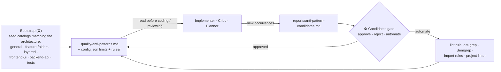

The **quality standard** applies to every agent that writes code:
- **Smallest complete change:** reuse what exists, then the standard library, then an installed dependency, then the minimum new code.
- **No comments,** except `shortcut: <limit>, <when to upgrade>` markers and tool directives.
- **Limits as signals of mixed responsibilities:** file ≤ 400 lines, function ≤ 30, parameters ≤ 4, cyclomatic complexity ≤ 10, nesting ≤ 3.
- **Structure:** declarative names, single responsibility, feature folders when the project already uses them (the existing structure wins), and patterns only for problems present now.

The **quality gate** checks only the feature's changes against its base:
- file length, flagged only for files that are new or grew;
- full-line comments;
- function size and complexity with `lizard` if it is installed;
- the project's checks from `config.json`.

## 10. Several features and several orchestrators

Sources: `protocols/multi-feature.md`, `protocols/hierarchy.md`, `protocols/orchestrator-memory.md`.

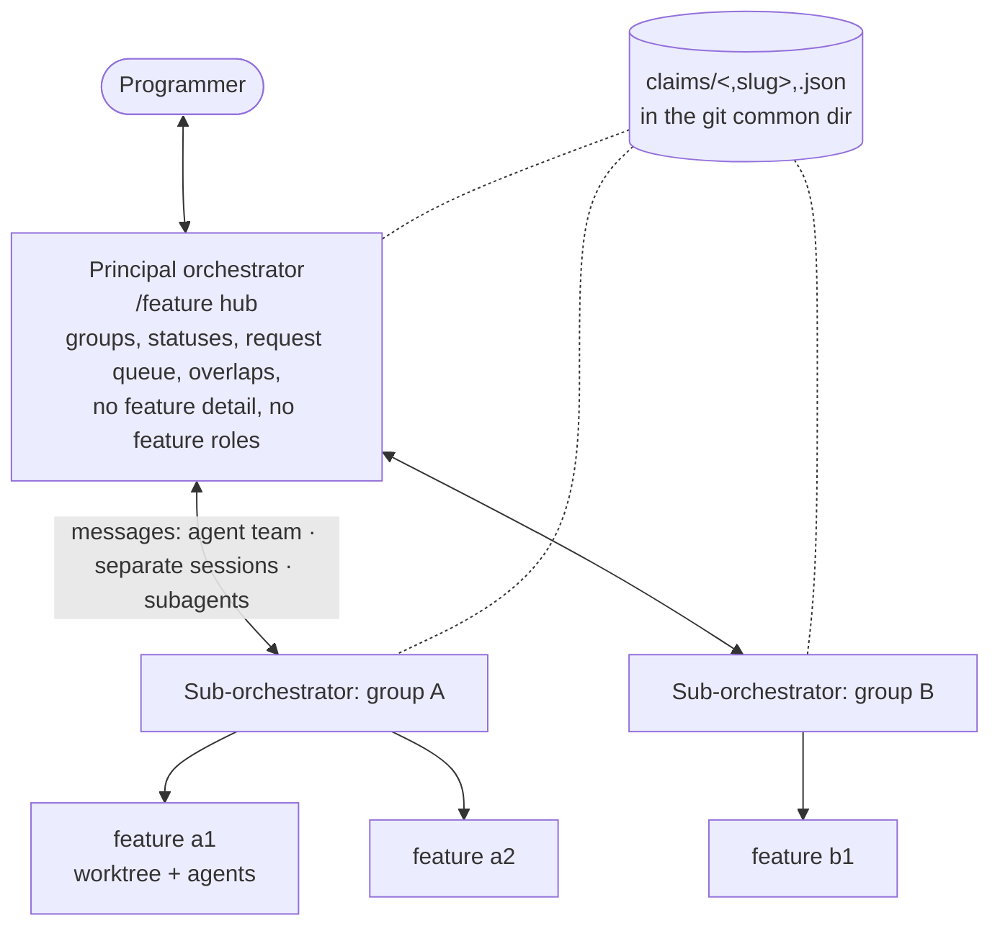

- **Single orchestrator, several features:**
  - Each feature has its own workflow, intensity, gates, artifacts and agents.
  - A gate in one feature never blocks another.
  - Agents of the same phase launch together across features.
  - Overlapping files between features are reported early, as facts.
- **Independent sessions** see each other only through claims. Two orchestrators never run the same feature.
- **Hierarchy:**
  - The principal is the programmer's only channel.
  - Each gate of a sub-orchestrator travels up as a `DECISION-REQUEST`.
  - The queue is ordered by how much work a request blocks, then by arrival.
  - The principal never prioritizes features: that stays the programmer's decision.
### Specialists

Source: `protocols/specialists.md`.

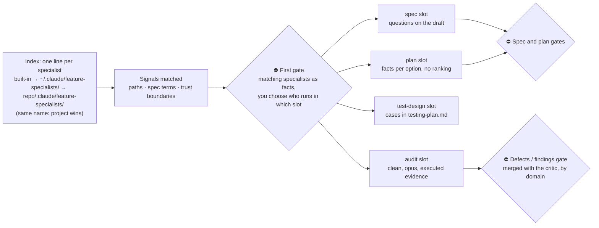

- **Two kinds:** advisors (`spec`, `plan`, `test-design`) can be resumed; auditors are always new, never fixed automatically, and re-run on the fix diff after a fix.
- **Mandatory specialists:** a specialist declares `mandatory-when: critical` in its file to run on every Critical feature its signals match. The built-in `security` specialist does.
- **Re-check:** signals are checked again against the real diff before verification, so a specialist that now matches is offered again.

### Phased mode (optional, experimental)

Source: `protocols/phase-runners.md`. Direct mode is the default.

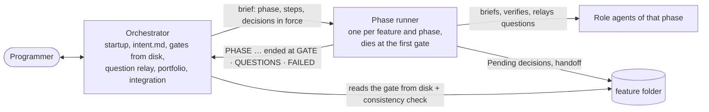

- **Phases:** SDD Direct has Specification, Planning, Build and Fixes. ESDD has Initial specification, Exploration, Increment and Evolution.
- **Experimental, never run.** By design the decisions are the same: the runner cannot reach the programmer, so it must stop at each gate. That has not been tested.
- **What changes:** you see results at the gates instead of agent by agent, and you can stop a whole runner but not steer it mid-phase.

- **Project memory** (`memory.md`, ≤ 80 lines) carries the project context and the portfolio across sessions. Before every stop, pending decisions are written to `decisions/` with their option labels, so an answer like "B" still resolves in a fresh session.

## 11. Responsibilities per agent

Standard executor and model. The orchestrator picks the cheapest sufficient model for each delegation, within the floors, and logs it in `delegations.md`.

| Agent | Executor · standard model | Responsible for | Reads | Writes | Never |
| --- | --- | --- | --- | --- | --- |
| **Orchestrator** | main session | Talking to the programmer, worktrees, intensity and workflow selection, the intent record `intent.md` (original request, the programmer's statements verbatim, Current intent), briefs, verifying returns, relaying questions, gates, decision records, handoffs between phases, delegation log, final report, integration and cleanup on approval | Only the skill files the current step needs; artifacts; reports | `intent.md`, `decisions/`, handoffs for read-only roles, `delegations.md`, `reports/review/rounds.md`, `final-report.md`, `memory.md`, claims | Recommend or rank options (except the review level), write production code, approve on the programmer's behalf, integrate or delete without confirmation |
| **Repository Analyst** | `Explore` · haiku (sonnet for large or unfamiliar code) | Evidence for one task: components, dependencies, conventions, existing behavior, tests and commands, architecture style, quality and E2E tooling; observed vs inferred | The feature worktree, only what the brief needs | Nothing: returns a context report of about 600 words | Recommend approaches, assume a stack without evidence, modify files |
| **Specification Writer** | `general-purpose` · opus (sonnet for short, clear requests; never haiku) | Turning the request into the current reading of its intent (not a closed contract): the source version of the intent record, the reach of its broad statements, FR/NFR, constraints, invariants, Given/When/Then criteria, what is outside the intent (and who drew each boundary) and open questions, each item traced to a source; ESDD statuses; applying approved spec changes | `intent.md`, handoff, the specification guide and template, the repository (read-only) | `specification.md` (Draft) | Invent requirements, resolve ambiguity, include implementation details, write vague criteria to avoid a question |
| **Planner** | `Plan` · opus (sonnet for one mechanical approach; never haiku) | The solution space: viable approaches in the neutral format, per-option outlines that follow the quality standard, the E2E harness, other decisions needed, excluded options with the constraint they violate | Handoff, spec sections, code, registry | Nothing: returns the decision block | Choose, rank, change requirements, add speculative abstractions |
| **Test Designer** | `general-purpose` · sonnet (opus if Critical; never haiku) | Test cases derived from the approved spec alone, in parallel with the Planner: each technique applied or justified, error, security, worst-case and E2E cases, traceability from every AC to its cases | Spec, analyst report, testing techniques, E2E guide (never the plan or code) | `testing-plan.md` | Invent expected results, design around an implementation, write test code |
| **Implementer** | `general-purpose` · sonnet (haiku if mechanical, opus if risky) | Production code for the approved plan only, to the quality standard. Self-review against the critic's checklist before the quality gate, so review finds little to rework. Runs the existing tests; **writes no tests** (Lite is the exception). Makes the Tester's reproducing tests pass when resumed for fixes. | Handoff, plan, testing plan, quality standard, design patterns, registry | Production code, `implementation-report.md`, handoff to testing, Lite card result | Write tests (outside Lite), drift from the plan silently, add comments, leave quality violations unreported, expand scope |
| **Tester** | `general-purpose` · sonnet (haiku for re-runs, opus for hard state) | The only author of tests: implements every designed case, runs functional, regression and E2E testing, explores beyond the plan, mutation testing if decided, validation against the spec. Keeps failing tests as reproductions for fixes. Resumed to re-run after fixes. | Handoff, testing plan, spec, testing techniques, E2E guide | Tests, case statuses in `testing-plan.md`, `reports/e2e/`, `validation-report.md`, handoff | Change a designed expected result, decide one the spec leaves open, weaken or skip failing tests, report a test it did not run as passed |
| **Clean Code Critic** | `general-purpose` · opus (never haiku) | Maximally critical review from scratch: names, responsibilities, function design, structure, patterns misused, registry violations, places the request's words reach that the diff leaves untouched; each finding with a concrete case | The original request and the programmer's statements, verbatim; code, `git diff <base>`, project conventions, quality standard, registry | `reports/review/round-<n>-critic.md` | Read the spec, plan, handoffs or earlier rounds; be reused across rounds |
| **Phase runner** (phased mode) | `general-purpose` · sonnet (opus if Critical; never haiku) | Orchestrating one phase of one feature: delegating its steps, choosing models, verifying returns, relaying agent questions, writing the gate's Pending decisions | Its brief, `SKILL.md` §4, the workflow steps in range, intensity and agent-questions protocols | `delegations.md`, `decisions/` (Pending), `handoff.md` | Talk to the programmer, pass a gate, run startup or integration, be reused for the next phase |
| **Finding Verifier** | `general-purpose` · sonnet (never haiku) | Trying to refute each finding against the code: VALID, INVALID or AMBIGUOUS; fix class; recurring findings marked as candidates | The critic's report, the code | `reports/review/round-<n>-verification.md` | Read the spec or plan, fix code, accept a finding without checking it |
| **Specialists** | `general-purpose` · sonnet in `spec`/`plan`/`test-design`, opus in `audit` (never haiku there) | Domain expertise in the slots you activate: questions on the spec draft, facts per plan option (never a recommendation), test cases, and a clean audit with executed evidence (exploit, query plan, timing, screenshot) | Advisory slots: request, spec, options. Audit: the diff and the code it reaches only | Questions, facts, cases in `testing-plan.md`, `reports/review/<name>.md` | Add requirements, recommend options, report unproven findings as confirmed, install tools, be resumed in `audit` |

**Floors:** no haiku for specification, planning, critic, verifier or phase runner. Critical features use opus for specification, planning, the critic and phase runners.

**Shared rules for every subagent:**
- **Location:** run without `isolation`. Confirm the feature branch first, and work through absolute paths (`cd <worktree> && …`). Never call `EnterWorktree`.
- **No delegation:** feature roles never spawn further agents.
- **Headless:** every subagent runs in the background. The programmer sees one line when an agent starts or finishes, and the full content only at gates.
- **Reuse:** when work returns to a role that already ran for the feature (fixes, re-tests, spec changes, the next increment), the same agent is resumed with `SendMessage`, and its ID is recorded in `handoff.md`. Critics and verifiers are never resumed.
- **Questions:** questions only the programmer can answer follow the agent-questions protocol. A blocking one stops the agent; it never guesses.
- **Return:** a `STATUS` line, a summary within the word limit, the questions, and any decision in the neutral format.

## 12. Artifacts and state

```
<repo>/.claude/worktrees/<slug>/                 feature worktree, own branch
└── docs/features/<slug>/                        or the project's own convention
    ├── intent.md                orchestrator        original request + statements S-n + Current intent
    ├── specification.md         Specification Writer  versioned; change log
    ├── implementation-plan.md   orchestrator        approved approach only
    ├── testing-plan.md          Test Designer (cases) · Tester (statuses)
    ├── decisions/D-NNN-*.md     orchestrator        Pending → decided, full option block
    ├── reports/
    │   ├── implementation-report.md   Implementer
    │   ├── validation-report.md       Tester
    │   ├── anti-pattern-candidates.md orchestrator (from agents)
    │   ├── e2e/                       Tester: traces, screenshots, logs
    │   ├── review/rounds.md · round-<n>-critic.md · round-<n>-verification.md
    │   └── final-report.md            orchestrator
    ├── delegations.md           orchestrator        role · model · reason · outcome
    └── handoff.md               outgoing agent      overwritten at each transition
    (Lite: feature.md card + decisions/ instead of the set above)

<repo>/.quality/ or <git-common-dir>/quality/   project-wide registry, after the programmer's approval
<git-common-dir>/feature-workflow/memory.md      project memory, ≤ 80 lines, never committed
<git-common-dir>/feature-workflow/claims/        one JSON per feature: who orchestrates it
```

**Handoffs** transfer knowledge, not conversation (`protocols/context-handoff.md`):
- **Transitions:** Request → Specification, Specification → Planning, Planning → Implementation, Implementation → Testing, Testing → Evolution (ESDD), and Testing → Finalization. Each one has a checklist.
- **Content:** handoffs reference artifacts by path and section instead of copying them, and record freshness (commit, branch, dirty state, artifact versions).
- **Critics and verifiers** never read handoffs.

## 13. Design principles

1. **The programmer decides.** Options are neutral: alphabetical, with symmetric pros and cons, facts instead of adjectives, and excluded options listed with the constraint they violate. The one exception is the review level, which is recommended and then validated.
2. **Artifacts are the source of truth.** Any feature can be resumed in a new session from its folder.
3. **Separation of concerns:** spec (what and why) ≠ plan (how) ≠ implementation ≠ validation, and each feature is separate from every other.
4. **Explicit uncertainty and evidence:** claims carry a status. A test that was not run is never "passed".
5. **No silent drift:** deviations, scope changes and behavior changes go back to the programmer.
6. **Ask, don't guess:** gaps become questions relayed by the orchestrator, never invented requirements.
7. **Clean review:** whoever reviews code never saw it being written.
8. **Pay only for what is needed:** progressive loading, intensity levels, a model chosen per delegation, and batched launches and verification. Correctness still beats economy.
