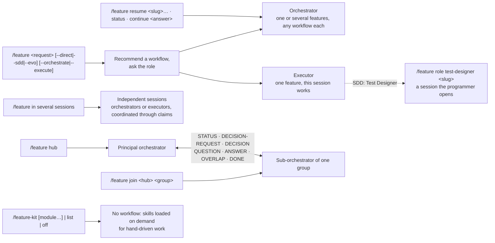
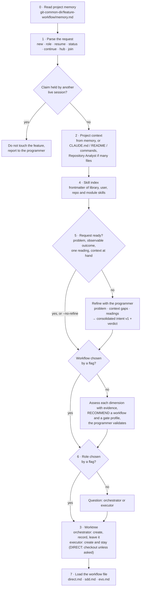
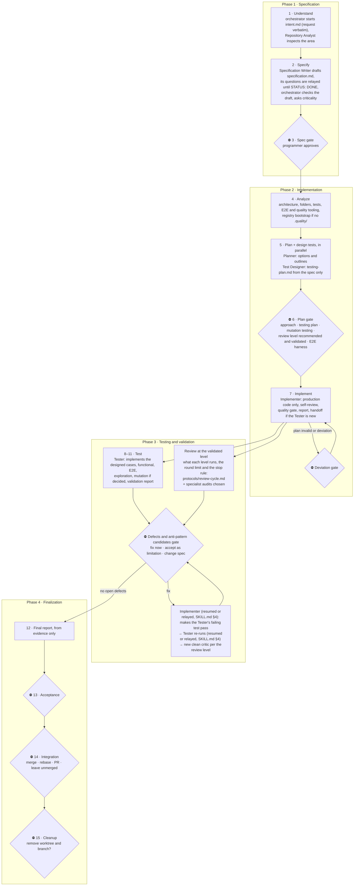
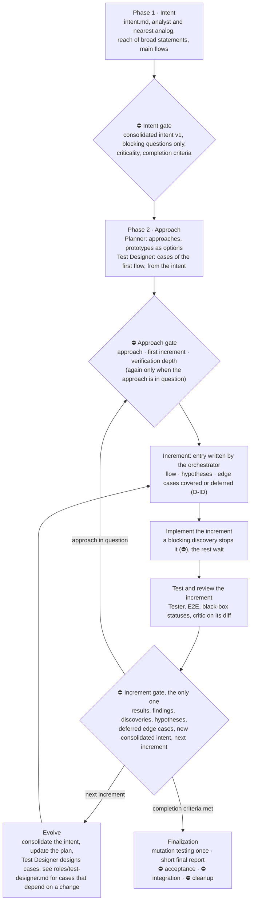
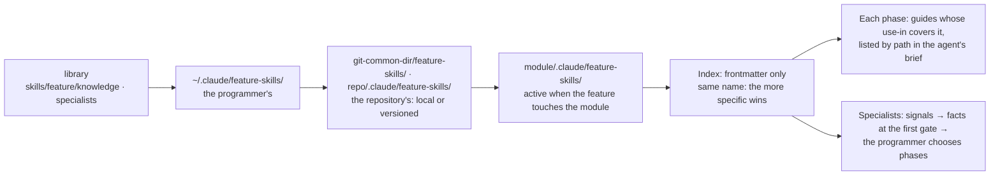
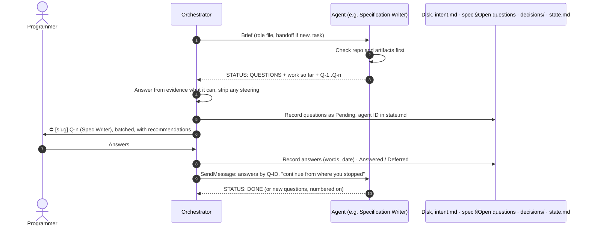
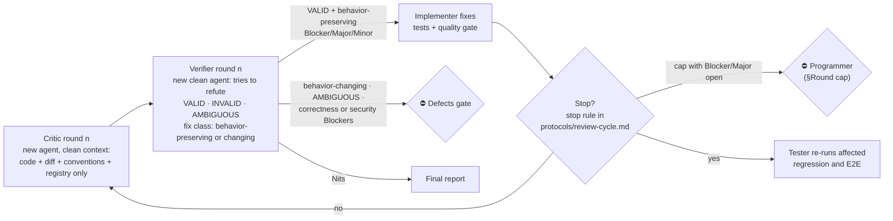
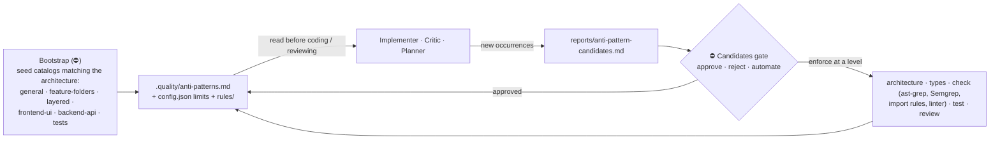
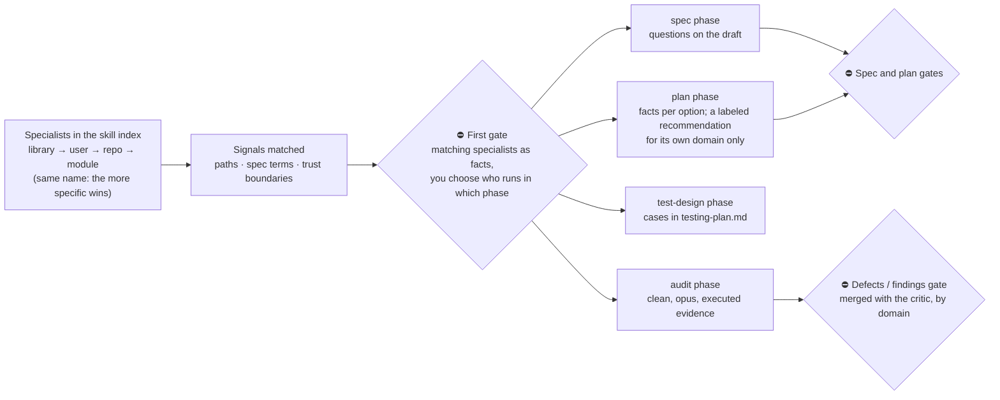
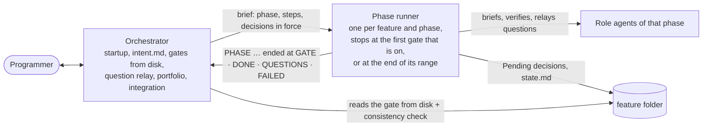

# Architecture of the Feature Workflow

There are two entry points: `/feature` and `/feature-kit`. Each feature in `/feature` has a **workflow** (DIRECT, SDD or EVO) and the session has a **role** (orchestrator or executor). Most of this document describes how the orchestrated workflows are built: who takes part, how a feature moves from request to integration, which files hold the state, and what each agent is responsible for. The behavior itself is defined by the files under `skills/feature/`. When this document and those files disagree, the files win, and each section names the file it summarizes.

Diagrams use Mermaid and render on GitHub.

## Contents

1. [Building blocks](#1-building-blocks)
2. [Entry points and modes](#2-entry-points-and-modes)
3. [Startup of a feature](#3-startup-of-a-feature)
4. [SDD](#4-sdd)
5. [EVO and Hybrid](#5-evo-and-hybrid)
6. [Skills and their classification](#6-skills-and-their-classification)
7. [Agent questions](#7-agent-questions)
8. [Review cycle](#8-review-cycle)
9. [Anti-pattern registry and quality gate](#9-anti-pattern-registry-and-quality-gate)
10. [Several features and several orchestrators](#10-several-features-and-several-orchestrators), including phased mode
11. [Responsibilities per agent](#11-responsibilities-per-agent)
12. [Artifacts and state](#12-artifacts-and-state)
13. [Design principles](#13-design-principles)

## 1. Building blocks


| Block | What it is | Source |
| --- | --- | --- |
| **Programmer** | Makes every consequential decision: requirements, scope, architecture, dependencies, trade-offs, acceptance, integration. | `SKILL.md` §1 |
| **Orchestrator** | The main session after `/feature`, in orchestrator role. The only party that talks to the programmer. It parses requests, creates worktrees, briefs subagents, verifies what they return, relays their questions, presents gates and records decisions. It writes no production code. | `SKILL.md` |
| **Executor** | The main session after `/feature`, in executor role: it does one feature's work itself; only the critic (with its verifier at R2) and audits are subagents, and in SDD the Test Designer is a session the programmer opens. | `protocols/executor.md` |
| **Subagents** | Claude Code built-in subagents (`Explore`, `Plan`, `general-purpose`) with a model chosen per task. Each one is pointed at its role file and never delegates further. | `SKILL.md` §4 |
| **Skill library** | Markdown files read only when a step needs them (progressive loading), plus one script. Knowledge and specialists are classified skills, extensible per user, repository and module (§6). | `SKILL.md` §3, `protocols/skills.md` |
| **Feature worktree** | One git worktree and branch per feature. Code and artifacts travel together on that branch. | `SKILL.md` §2.3 |
| **`.quality/`** | The project's quality configuration and anti-pattern registry. It outlives features. The programmer chooses at bootstrap whether it is versioned (`<repo>/.quality/`) or local to the clone (`<git-common-dir>/quality/`). | `protocols/anti-pattern-registry.md` |
| **Git common dir** | Shared by every worktree and never committed: the orchestrator's project memory and the feature claims. | `protocols/orchestrator-memory.md`, `protocols/hierarchy.md` |

## 2. Entry points and modes



| Workflow | Orchestrator | Executor |
| --- | --- | --- |
| **DIRECT** | One Implementer subagent runs the edge-case checklist, writes code and tests, and reports; the orchestrator relays blocking questions and runs integration | The session does it in the current checkout (or a worktree if asked). No gates before integration; a critic only if asked |
| **SDD** | Every role is a subagent (§4) | The session specifies, plans, implements and tests. The Test Designer runs in a session the programmer opens, so it never sees the plan. Critic and audits are subagents |
| **EVO** | Every role is a subagent (§5) | The session runs the increments with one card; gates 3 and 5 are merged. The review at the validated level and the audits are subagents, per increment ([`executor.md`](executor.md)) |

| Command | Effect |
| --- | --- |
| `/feature refine <request>` | Refines a request with the programmer without starting a feature; saves the record locally for `/feature refined <slug>`. |
| `/feature <request>` | Checks whether the request is ready and refines it if not, recommends a workflow with its evidence, asks the role, and starts. In an orchestrating session, adds to the portfolio; features in progress are never reset. |
| `/feature role <role> <slug>` | A session that runs one role of an executor's feature, from the brief the executor wrote. |
| `/feature resume <slug>…` | Continues features from their `state.md` or card, after a freshness check. |
| `/feature status` | Board of every feature in progress, plus the ones other sessions claim. |
| `/feature continue <answer>` | A fresh session answers a pending gate, using `memory.md` and `decisions/` on disk. |
| `/feature hub`, `/feature join <hub> <group>` | Hierarchical mode (§10). |
| `/feature correct` | Correction sweep: classes of repeated mistakes, enforced at the level the programmer chooses (§9). |
| `/feature verify-skill app\|formal [<target>]` | Generates a repository verification skill (§6). |
| `/feature-kit` | Separate skill. It exposes the roles and skills as modules (edge-cases, explore, spec, plan, decide, quality/ponytail, patterns, antipatterns, test, e2e, gate, review, writing, measure, correct, verify-skill, formal-skill, card, specialists) plus the programmer's, repository's and modules' own skills, without phases, gates, artifacts or worktrees. Only `review` launches subagents. |

`feature-kit` has `disable-model-invocation: true`: it loads only when the programmer types the command. `feature` does not, so Claude can launch it when the programmer explicitly asks for a feature; its description says never on its own initiative.

## 3. Startup of a feature

Source: `SKILL.md` §2.



- **Refinement** (`protocols/refinement.md`) runs before the recommendation when the request is not ready: it names a solution without its problem, its outcome is not observable, several readings survive, or it needs context only someone else has. The session restates the request as a problem, finds what the repository can answer, asks the rest from fixed dimensions, offers two or three readings plus the smallest version, and stops when the programmer confirms version 1 of the intent. It runs in every gate profile (one round in `auto`). `/feature refine` runs it alone, without starting a feature.
- **Dimensions** for the workflow recommendation, assessed on the refined intent when refinement ran: requirement clarity, functional uncertainty, technical feasibility, architectural uncertainty, expected discoveries, need for prototypes, risk and reach. The role is a question; as with every decision, the agent may recommend one, labeled.
- **Gate profile** (`protocols/gates.md`), recommended with the workflow: `full` (every gate) for likely Critical features, `key` (the default) for SDD and EVO, `auto` for DIRECT. Per-gate changes with `--gates key,+increment,-intent`.

| Gate | `full` | `key` | `auto` |
| --- | --- | --- | --- |
| `intent` (spec approval, intent gate) | stops | stops | agent |
| `specialists` | stops | agent: mandatory and `--with` run | agent |
| `bootstrap` (registry) | stops | stops | agent: local registry only |
| `approach` | stops | stops when options differ in API, data, dependencies or shared structure | agent |
| `depth` (testing plan, mutation, review level, E2E harness) | stops | agent: defaults; review level per `protocols/gates.md` §When a gate is off | same |
| `increment` (EVO) | stops | report and continue, unless a gate still on or a stop in `protocols/gates.md` applies | same, as a catch-up (`SKILL.md` §5) |
| `defects` | stops | Implementer fixes the critic's and the Tester's Blocker and Major the programmer's words cover (test first when the fix changes behavior); audit findings (a security Blocker always stops) and the rest to acceptance (cap with one open: stop, `protocols/review-cycle.md` §Round cap) | same |
| `discoveries` | stops | stops when outside or contradicting the intent | agent: covered ones fixed, outside ones not built, listed; contradicting: stops |
| `candidates` | stops | at acceptance | listed only |
| `acceptance` | stops | stops | stops |

A gate that is off is decided by the agent with its recommendation, recorded as *Decided by agent* and listed in the final report; in `auto`, a choice between rules the author wrote goes to the programmer instead (`protocols/gates.md` §When a gate is off). What always stops, in every profile, is listed in `protocols/gates.md` §Hard stops. Questions are always allowed.

- **Worktree failures** (not a git repository, a git error, already inside a worktree session) stop the feature and are presented to the programmer. The orchestrator never falls back to the shared checkout.

## 4. SDD

For well-understood features. Source: `workflows/sdd.md`. ⛔ is a human gate: it stops this feature only, and other features keep moving.



**Definition of done** (checked before acceptance):
- Spec and plan are approved.
- The scope matches, and any deviation is approved.
- Every acceptance criterion has evidence.
- E2E and every black-box technique have a status.
- The quality gate passes, or each remaining violation has a decision.
- Anti-pattern candidates were presented.
- Mutation testing and review ran as decided.
- Regressions were evaluated, and no blocking issue is hidden.

## 5. EVO and Hybrid

For features with open requirements or technical unknowns. Source: `workflows/evo.md`. **There is no specification:** the intent record (`intent.md`), the programmer's decisions (`decisions/`) and the designed cases (`testing-plan.md`, the executable criteria) carry what the feature must do, increment by increment, main flows first.



- **Leaner by design:** one gate per increment, the Planner only at the start and when the approach is in question, mutation testing once at the end, `handoff.md` only when a new agent takes over a phase (relay notes instead for a new agent of a role that already ran: `protocols/context-handoff.md` §Relay; resume state in `state.md`), and a short final report that links the intent, the cases and the decisions.
- **Hypotheses** are the team's, kept in the plan's *Increments* with their status (Hypothesis, Under exploration, Confirmed, Rejected) and evidence. The programmer's words stay in the intent record.
- **Deferred edge cases** need a programmer decision naming the increment that will cover them; they never accumulate silently.
- **Prototypes** live outside production paths. They are discarded unless the programmer promotes them.
- **Hybrid:** SDD for the feature as a whole, with a specification; Phases 2–4 apply only to the uncertain area, marked *Under exploration*, until it can be specified.

## 6. Skills and their classification

Source: `protocols/skills.md`. Every piece of knowledge is a skill whose frontmatter says where it can be used.

| Field | Values |
| --- | --- |
| `kind` | `guide`: read by whoever does the phase · `specialist`: runs as its own agent in its phases |
| `use-in` | `intent` · `spec` · `plan` · `test-design` · `implement` · `test` · `review` · `audit` · or `general` |
| `workflows` | `direct` · `sdd` · `evo` (all when omitted) |
| `signals` | paths, terms, trust boundaries that make it relevant |
| `mandatory-when` | `critical` for specialists that must run on Critical features |



- **Library classification:** `edge-cases` general; `writing` general; `specification-guide` intent, spec, test-design; `code-quality` plan, implement, test, review; `design-patterns` plan, implement; `measurement` plan, test, review, audit (by signals); `testing-techniques` test-design, test; `e2e-testing` test-design, test; the six specialists in their phases.
- **Generated skills** (`protocols/verification-skills.md`): `/feature verify-skill app` writes `verify-<app>` (launch, doctor, drive, evidence, cleanup, feature map; test-design, test, review); `/feature verify-skill formal` writes `formal-<area>` (a property checked by a model checker or verifier, with its coverage record and sync commit; plan, test, review). Each is proven once before handover, and checked for drift when a diff touches its paths.
- **DIRECT** has no phases: it loads skills on demand; `--no-skills` leaves only the edge-case checklist.
- **Why not `.claude/skills/`:** Claude Code loads those descriptions into every session; these folders load only when the workflow runs.

## 7. Agent questions

Subagents cannot talk to the programmer, so they ask through the orchestrator. Source: `protocols/agent-questions.md`.



- **Blocking** questions are the ones whose answer changes the agent's output: a requirement, scope, observable behavior, a constraint, the viable approaches, or a test's expected result. The agent stops and does not guess. A question that changes the output for a valid input is always blocking, and the agent never weakens an acceptance criterion to avoid it.
- **Non-blocking** questions: the agent continues under an assumption labeled Hypothesis and lists it. The question goes to the next gate.
- **If the agent cannot be resumed** (a new session or an error), a new agent takes over through a relay (`protocols/context-handoff.md` §Relay) with the earlier "work so far" and the answers.
- **Answers that change approved work** become a spec version bump or a decision record. Approved work never changes silently.
- **Critics and verifiers never ask:** they report ambiguity as a finding.

## 8. Review cycle

Source: `protocols/review-cycle.md`. The orchestrator **recommends** the level with evidence, and the programmer validates it. 

| Level | What runs | Typical feature |
| --- | --- | --- |
| R0 | Quality gate and project lint only | Mechanical change, about 50 changed lines, no risk areas |
| R1 | One clean critic, in parallel with the Tester | Standard feature with new logic |
| R2 | The cycle in `protocols/review-cycle.md` §R2 · The cycle | Critical, or large or complex |



- **Cap reached with a Blocker or Major open** (`protocols/review-cycle.md` §Round cap): the feature stops and asks the programmer, in every profile. Commits made after the last round reach acceptance marked unreviewed (`protocols/review-cycle.md`).

- **Review level:** the default, the recommendation and what a standing "accept your recommendation" covers are in `protocols/review-cycle.md` §Review levels; with the `depth` gate off, `protocols/gates.md` §When a gate is off decides.
- **Automatic fixes** happen only at R2, except that with the `defects` gate off the Implementer (resumed or relayed, `SKILL.md` §4, *Reusing agents*) fixes the critic's and the Tester's covered Blocker and Major at any level (`protocols/gates.md`). Each one is listed at the next gate with its hunks and a revert option. The orchestrator never changes code itself (`SKILL.md` §1, principle 9).
- **Convergence:** what each round reviews and reports is in `protocols/review-cycle.md` §R2 · The cycle.
- **Clean context:** the critic and the verifier never read the spec, plan, decisions, handoffs, implementation report or earlier rounds. Each round launches a **new** critic.
- **Round log** in `reports/review/rounds.md`. Findings that recur become anti-pattern candidates. The INVALID rate shows how noisy the critic is.
- **Why it is built this way:** self-attribution and self-preference bias in LLM evaluators, adversarial refutation, and diminishing returns after three or four repair iterations. The papers are cited in [`references.md`](references.md).

## 9. Anti-pattern registry and quality gate

Sources: `protocols/anti-pattern-registry.md`, `knowledge/code-quality.md`, `scripts/quality_gate.py`.



**Enforcement levels** go from making the mistake impossible (architecture, types) to catching it (a check, a test) to describing it (review); the programmer chooses per entry, and each new check is proven on a real past occurrence. The programmer's own corrections become candidates. `/feature correct` sweeps commits, reverts and review comments for classes of repeated mistakes (two occurrences make a class) and enforces the chosen ones, one commit each.

The **quality standard** applies to every agent that writes code:
- **Smallest complete change:** reuse what exists, then the standard library, then an installed dependency, then the minimum new code.
- **No comments,** except `shortcut: <limit>, <when to upgrade>` markers and tool directives.
- **Limits as signals of mixed responsibilities:** file ≤ 400 lines, function ≤ 30, parameters ≤ 4, cyclomatic complexity ≤ 10, nesting ≤ 3.
- **Structure:** declarative names, single responsibility, feature folders when the project already uses them (the existing structure wins), and patterns only for problems present now.
- **Root causes:** reproduce, ask whether the triggering state is legitimate (if not, a guard hides the bug), fix the pattern; after two failed fixes with one premise, write the premise down and test it before a third.
- **Design principles:** model the domain in data structures, data shape before logic, validation only at boundaries, subtract before adding.

The **quality gate** checks only the feature's changes against its base:
- file length, flagged only for files that are new or grew;
- full-line comments;
- function size and complexity with `lizard` if it is installed;
- the project's checks from `config.json`.

## 10. Several features and several orchestrators

Sources: `protocols/multi-feature.md`, `protocols/hierarchy.md`, `protocols/orchestrator-memory.md`.


- **Single orchestrator, several features:**
  - Each feature has its own workflow, gates, artifacts and agents.
  - A gate in one feature never blocks another.
  - Agents of the same phase launch together across features.
  - Overlapping files between features are reported early, as facts.
- **Independent sessions** see each other only through claims. Two orchestrators never run the same feature.
- **Hierarchy:**
  - The principal is the programmer's only channel.
  - Each gate of a sub-orchestrator travels up as a `DECISION-REQUEST`.
  - The queue is ordered by how much work a request blocks, then by arrival.
  - The principal never prioritizes features: that stays the programmer's decision.
### Specialists

Source: `protocols/skills.md`.



- **Two kinds:** advisors (`spec`, `plan`, `test-design`) can be resumed; auditors are always new, never fixed automatically, and re-run on the fix diff after a fix.
- **Mandatory specialists:** a specialist declares `mandatory-when: critical` in its file to run on every Critical feature its signals match. The built-in `security` specialist does.
- **Re-check:** signals are checked again against the real diff before verification, so a specialist that now matches is offered again.

### Phased mode (optional, experimental)

Source: `protocols/phase-runners.md`. Unphased mode is the default.



- **Phases:** SDD has Specification, Planning, Build and Fixes. EVO has Intent, Approach, Increment and Evolution.
- **Experimental, never run.** By design the decisions are the same: the runner cannot reach the programmer, so it must stop at each gate that is on. That has not been tested.
- **What changes:** you see results at the gates instead of agent by agent, and you can stop a whole runner but not steer it mid-phase.

- **Project memory** (`memory.md`, ≤ 80 lines) carries the project context and the portfolio across sessions. Before every stop, pending decisions are written to `decisions/` with their option labels, so an answer like "B" still resolves in a fresh session.

## 11. Responsibilities per agent

Standard executor and model. The orchestrator picks the cheapest sufficient model for each delegation, within the floors, and logs it in `delegations.md`.

| Agent | Executor · standard model | Responsible for | Reads | Writes | Never |
| --- | --- | --- | --- | --- | --- |
| **Orchestrator** | main session | Talking to the programmer, worktrees, workflow recommendation and role, the intent record `intent.md` (original request, consolidated intent confirmed at each gate, statements since), briefs, verifying returns, relaying questions, gates, decision records, handoffs between phases, delegation log, final report, integration and cleanup on approval | Only the skill files the current step needs; artifacts; reports | `intent.md`, `decisions/`, handoffs whose outgoing role writes none (read-only roles, Request → Specification, Specification or Intent → Planning and Test design), `state.md`, `delegations.md`, `reports/review/rounds.md`, `final-report.md`, `memory.md`, claims | Hide a recommendation in the order or wording of options, write production code, approve on the programmer's behalf at a gate that is on, integrate or delete without confirmation |
| **Repository Analyst** | `Explore` · haiku (sonnet for large or unfamiliar code) | Evidence for one task: components, dependencies, conventions, existing behavior, tests and commands, architecture style, quality and E2E tooling; observed vs inferred | The feature worktree, only what the brief needs | Nothing: returns a context report of about 600 words | Recommend approaches, assume a stack without evidence, modify files |
| **Specification Writer** | `general-purpose` · opus (sonnet for short, clear requests; never haiku) | Turning the request into the current reading of its intent (not a closed contract): the source version of the intent record, the reach of its broad statements, FR/NFR, constraints, invariants, Given/When/Then criteria, what is outside the intent (and who drew each boundary) and open questions, each item traced to a source; Hybrid statuses; applying approved spec changes. Not used in EVO | `intent.md`, handoff, the specification guide and template, the repository (read-only) | `specification.md` (Draft) | Invent requirements, resolve ambiguity, include implementation details, write vague criteria to avoid a question |
| **Planner** | `Plan` · opus (sonnet for one mechanical approach; never haiku) | The solution space: viable approaches in the decision format, per-option outlines that follow the quality standard, the E2E harness, other decisions needed, excluded options with the constraint they violate | Handoff, spec sections, code, registry | Nothing: returns the decision block | Choose, rank, change requirements, add speculative abstractions |
| **Test Designer** | `general-purpose` · sonnet (opus if Critical; never haiku) | Test cases derived from the approved spec alone, in parallel with the Planner: each technique applied or justified, error, security, worst-case and E2E cases, traceability from every AC to its cases | Spec, analyst report, testing techniques, E2E guide (never the plan or code) | `testing-plan.md` | Invent expected results, design around an implementation, write test code |
| **Implementer** | `general-purpose` · sonnet (haiku if mechanical, opus if risky) | Production code for the approved plan only, to the quality standard. Self-review against the critic's checklist before the quality gate, so review finds little to rework. Runs the existing tests; **writes no tests** (exceptions: DIRECT, a fixture or helper the plan assigns, an anti-pattern entry's check or test). Makes the Tester's reproducing tests pass when resumed for fixes. Copies of the rules it touches and verification after committing: `roles/implementer.md` §Rules touched and verification. | Handoff, plan, testing plan, quality standard, design patterns, registry | Production code, `implementation-report.md`, handoff to testing (new Tester only), DIRECT report | Write tests (outside those exceptions), drift from the plan silently, add comments, leave quality violations unreported, expand scope |
| **Tester** | `general-purpose` · sonnet (haiku for re-runs, opus for hard state) | The author of the tests (except the Implementer's exceptions): implements every designed case, runs functional, regression and E2E testing, explores beyond the plan, mutation testing if decided, validation against the spec. Keeps failing tests as reproductions for fixes. Resumed to re-run after fixes. | Handoff, testing plan, spec, testing techniques, E2E guide | Tests, case statuses in `testing-plan.md`, `reports/e2e/`, `validation-report.md`, handoff (new agent only) | Change a designed expected result, decide one the spec leaves open, weaken or skip failing tests, report a test it did not run as passed |
| **Clean Code Critic** | `general-purpose` · opus (never haiku) | Maximally critical review from scratch: names, responsibilities, function design, structure, patterns misused, registry violations, places the request's words reach that the diff leaves untouched; each finding with a concrete case | The original request and the programmer's statements, verbatim; code, `git diff <base>`, project conventions, quality standard, registry | `reports/review/round-<n>-critic.md` (EVO: `inc<k>-round-<n>-critic.md`) | Read the spec, plan, handoffs or earlier rounds; be reused across rounds |
| **Phase runner** (phased mode) | `general-purpose` · sonnet (opus if Critical; never haiku) | Orchestrating one phase of one feature: delegating its steps, choosing models, verifying returns, relaying agent questions, writing the gate's Pending decisions | Its brief, `SKILL.md` §4, the workflow steps in range, skills and agent-questions protocols | `delegations.md`, `decisions/` (Pending), `state.md` | Talk to the programmer, pass a gate, run startup or integration, be reused for the next phase |
| **Finding Verifier** | `general-purpose` · sonnet (never haiku) | Trying to refute each finding against the code: VALID, INVALID or AMBIGUOUS; fix class; recurring findings marked as candidates | The critic's report, the code | `reports/review/round-<n>-verification.md` (EVO: `inc<k>-round-<n>-verification.md`) | Read the spec or plan, fix code, accept a finding without checking it |
| **Specialists** | `general-purpose` · sonnet in `spec`/`plan`/`test-design`, opus in `audit` (never haiku there) | Domain expertise in the phases you activate: questions on the spec draft, facts per plan option (a recommendation only for its own domain, labeled), test cases, and a clean audit with executed evidence (exploit, query plan, timing, screenshot) | Advisory phases: request, spec, options. Audit: the diff and the code it reaches only | Questions, facts, cases in `testing-plan.md`, `reports/review/<name>.md` | Add requirements, recommend options outside its domain, report unproven findings as confirmed, install tools, be resumed in `audit` |

**Floors:** no haiku for specification, planning, test design, the critic, the verifier, a specialist's audit or a phase runner. Critical features use opus for specification, planning, test design, the critic, specialist audits and phase runners.

**Shared rules for every subagent:**
- **Location:** run without `isolation`. Confirm the feature branch first, and work through absolute paths (`cd <worktree> && …`). Never call `EnterWorktree`.
- **No delegation:** feature roles never spawn further agents.
- **Headless:** every subagent runs in the background. The programmer sees one line when an agent starts or finishes, and the full content only at gates.
- **Reuse:** when work returns to a role that already ran for the feature, the same agent is resumed with `SendMessage`, or a new agent of the same role takes over through a relay, as `SKILL.md` §4, *Reusing agents*, decides. In a relay the outgoing agent writes notes on what it explored, and the new one reads them plus the whole diff. Each agent's ID, model and last token count are recorded in `state.md`. Critics and verifiers are never resumed. The relay is in `protocols/context-handoff.md` §Relay.
- **Pause and stop:** the programmer can pause a feature or stop all its work at once, and `state.md` records what must be relaunched (`SKILL.md` §7).
- **Catch-ups in `auto`:** the programmer gets one at each phase or increment transition without asking (`SKILL.md` §5).
- **Orchestrator cost:** the orchestrator session compacts at the threshold the programmer sets and is recommended to run on sonnet (README §Cost settings).
- **Questions:** questions only the programmer can answer follow the agent-questions protocol. A blocking one stops the agent; it never guesses.
- **Return:** a `STATUS` line, a summary within the word limit, the questions, and any decision in the decision format.

## 12. Artifacts and state

```
<repo>/.claude/worktrees/<slug>/                 feature worktree, own branch
└── docs/features/<slug>/                        or the project's own convention
    ├── intent.md                orchestrator        original request + consolidated intent + statements since
    ├── intent-history.md        orchestrator        absorbed statements, by consolidation version
    ├── specification.md         Specification Writer  versioned; change log
    ├── implementation-plan.md   orchestrator        approved approach only
    ├── testing-plan.md          Test Designer (cases) · Tester (statuses)
    ├── decisions/D-NNN-*.md     orchestrator        Pending → decided, full option block
    ├── reports/
    │   ├── implementation-report.md   Implementer
    │   ├── validation-report.md       Tester
    │   ├── anti-pattern-candidates.md orchestrator (from agents)
    │   ├── e2e/                       Tester: traces, screenshots, logs
    │   ├── review/rounds.md · round-<n>-critic.md · round-<n>-verification.md (EVO: inc<k>-round-<n>-…)
    │   └── final-report.md            orchestrator
    ├── delegations.md           orchestrator        role · model · reason · outcome
    ├── handoff.md               outgoing agent      message to a new agent at a phase transition
    └── state.md                 orchestrator        resume state, written at every stop
    (EVO as executor: feature.md card, whose State replaces state.md, + review/ + decisions/; SDD as executor: no handoff.md or delegations.md; DIRECT: none unless asked)

<repo>/.quality/ or <git-common-dir>/quality/   project-wide registry, after the programmer's approval
<git-common-dir>/feature-workflow/memory.md      project memory, ≤ 80 lines, never committed
<git-common-dir>/feature-workflow/relay/<slug>/  relay notes, one per role, never committed (protocols/context-handoff.md §Relay)
<git-common-dir>/feature-workflow/claims/        one JSON per feature: who orchestrates it
```

**Handoffs** transfer knowledge, not conversation (`protocols/context-handoff.md`):
- **When:** in orchestrator mode only, at a phase transition whose incoming agent is new; a resumed agent gets a brief instead, and a new agent of a role that already ran gets relay notes (`protocols/context-handoff.md` §Relay). Resume state lives in `state.md` (the card's *State* in EVO as executor and in DIRECT with a card).
- **Transitions:** Request → Specification, Specification → Planning, Planning → Implementation, Implementation → Testing, Intent → Planning and Intent → Test design (EVO), Testing → Evolution (EVO), and Testing → Finalization. Each one has a checklist.
- **Content:** handoffs reference artifacts by path and section instead of copying them, and record freshness (commit, branch, dirty state, artifact versions).
- **Critics and verifiers** never read handoffs.

## 13. Design principles

1. **The programmer decides, and the agent's view is in the open.** No presentation of options is neutral, since the agent picks the options and the words. So every decision shows each viable option with facts instead of adjectives, the options left out and those excluded by a constraint, and a labeled recommendation with its reasons and the fact that would change it. Nothing proceeds by silence.
2. **Artifacts are the source of truth.** Any feature can be resumed in a new session from its folder (DIRECT only with a card).
3. **Separation of concerns:** spec (what and why) ≠ plan (how) ≠ implementation ≠ validation, and each feature is separate from every other.
4. **Explicit uncertainty and evidence:** claims carry a status. A test that was not run is never "passed".
5. **No silent drift:** deviations, scope changes and behavior changes go back to the programmer, at a gate or, when its gate is off, as `protocols/gates.md` §When a gate is off describes.
9. **Supervision is chosen per feature:** the gate profile sets how often the programmer is stopped; what is hard to undo always stops.
6. **Ask, don't guess:** gaps become questions relayed by the orchestrator, never invented requirements.
7. **Clean review:** whoever reviews code never saw it being written.
8. **Pay only for what is needed:** progressive loading, skills indexed by frontmatter, three workflows from DIRECT up, a model chosen per delegation, and batched launches and verification. Correctness still beats economy.
