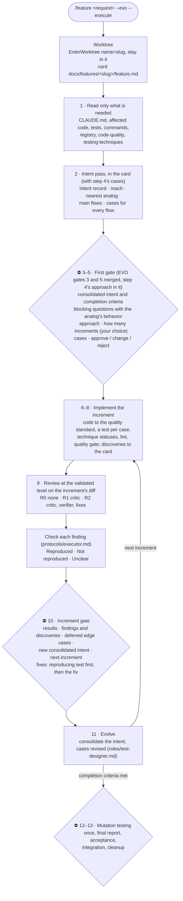

# Executor mode: one session does the feature

When you run `/feature` and choose **executor**, the session does the feature's work itself instead of orchestrating agents. This document explains it for each workflow, with the most detail for EVO, which is what `/feature-lean` used to be. The behavior is defined by [`skills/feature/protocols/executor.md`](../skills/feature/protocols/executor.md) and the workflow files; when they disagree with this document, they win.

| Workflow | What the executor does itself | What runs elsewhere | Artifacts |
| --- | --- | --- | --- |
| DIRECT | Everything: checklist, code, tests, self-review | A clean critic only if you ask | None, or a card if you ask |
| SDD | Exploration, specification, plan, code, tests, verification | The Test Designer, in a session **you** open with `/feature role test-designer <slug>` (it must design from the spec without seeing the plan); the critic and audits as subagents | `intent.md`, `specification.md`, `implementation-plan.md`, `testing-plan.md`, `decisions/`, `state.md` |
| EVO | Intent pass, cases, approach, code and tests per increment | The review at the validated level and the audits as subagents, per increment | One card, `feature.md`, plus `decisions/` |

## When to choose executor, and when orchestrator

| Executor | Orchestrator |
| --- | --- |
| One feature per session; several independent features run as parallel sessions | Several features coordinated in one portfolio, with overlap detection |
| You want to see and steer the work in the conversation | You want each role in its own agent, with its own context and model |
| The same session writes the code and its tests (except SDD's test design) | The Tester writes the tests, from cases a Test Designer designed (DIRECT: one Implementer writes code and tests) |
| You are on a plan with a usage limit: no orchestrator relay, which was 46% of all tokens in the measured run | The token budget is not a concern |

## EVO as executor

## The flow

The numbers in the flow are the steps of `workflows/evo.md` (checking findings comes from `protocols/executor.md`); the sections below have their own order. The session does all the work itself. The only subagents are the critics, the verifiers at R2 and the specialist audits you chose, per increment.

**Increments, if you want them.** The executor follows `workflows/evo.md` without its separate agents, and merges its intent and approach gates (3 and 5) into one first gate. There is no specification: the card's intent record, its decisions and its cases say what the feature must do. At the first gate you choose how to deliver it: one increment for the whole feature (one critic and one increment gate, the one-pass flow `/feature-lean` had before), one per main flow (a critic and a gate per flow), or another grouping. At each increment gate you can regroup what remains.

## Step by step

### 1. Worktree and card

The session calls `EnterWorktree` with the feature's slug and stays in it. It records the path, branch and base commit, and creates the card from `templates/feature-card.md`. The card's target is 500 lines; when a feature needs more, the overflow goes to linked files next to it (`decisions/`, `feature-appendix.md`), never cut.

### 2. Reading, on a budget

Only what the feature needs: CLAUDE.md, the affected code and its tests, the build, test and lint commands, the anti-pattern registry if the project has one, and the skill index (frontmatter only). Each skill is read when its phase starts: the edge-case checklist and the specification guide for the intent pass, the code-quality standard for implementation, the testing techniques for tests, and your own, the repository's or a module's skills where they are classified.

### 3. Intent pass

Written into the card before any code:
- **The intent record.** The request evolves as you talk, so the card keeps your original request verbatim, a consolidated intent you confirm at each gate (with the completion criteria: what "done" means for you), and your statements since, verbatim (S-1, S-2…), only those that change the intent. At each gate the session proposes a new consolidated version; once you confirm it, the absorbed statements move to an appendix, so the card does not grow with the conversation.
- **Scope:** for each broad statement ("everywhere that…", "all…", "consistently"), the searches run, by concept (`knowledge/edge-cases.md` §Before code, step 1), and the places found so far, including subclasses, overrides and copies of the same list. And what a reader might assume is included, marked as the session's reading, for you to confirm.
- **Nearest analog:** the existing feature of the project most like this one, with its `path:line`, and how it handles empty and invalid input, whitespace, exceptions from user objects, escaping and error messages.
- **Main flows:** the feature's main flows, in order, as the possible split into increments.
- **Cases** for every main flow: every case with its expected result, its source (your request, a statement, a decision, or existing behavior with `path:line`) and what the analog does: boundaries, empty and missing values, invalid values and encodings, error paths, duplicates and ordering, concurrency, security (escaping, injection, safe-marking, authorization), and the worst-case input. Cases of later flows may be revised when their increment starts.

### 4. First gate: intent, approach and first increment

One message, every item in full; the items of gates that are off in the feature's profile are handled as `protocols/gates.md` §When a gate is off describes and reported in it:
- the consolidated intent and completion criteria, and the readings to confirm;
- blocking questions, each with what the analog does as a fact and the agent's recommendation; questions that only later increments need wait for them;
- the approach: options in the decision format, each with its security consequence and its worst case (probed for parsers, regular expressions, escaping or safe-marking);
- how many increments, as a question (one for the whole feature, one per main flow, or your own grouping), with the cases in full; an edge case you want to defer needs your decision naming the increment that will cover it;
- choices by convention, one line each, which you may override;
- the specialists whose signals match, as facts, and which of them run;
- criticality: Critical makes mutation testing mandatory, once at the end; for a Standard feature, a question;
- the review level recommended, and the anti-pattern registry bootstrap when the project has none;
- approve, change or reject.

### 5. Implementation and tests, per increment

The session writes the increment's code to the quality standard and a test for every one of its cases. Each testing technique gets a status for the increment; inputs that cross a trust boundary get fuzz or property-based tests; a user-facing flow gets an end-to-end test when the project has a harness. Then lint, type checks and the quality gate. Anything found that the gates did not settle goes to the card's *Discoveries*; only one that blocks the work is asked at once.

### 6. The review, per increment, and the specialist audits you chose

At the level you validated: R0 no critic; R1 one critic; R2 critic, verifier, fixes and a new critic, up to 3 rounds (Critical is always R2). The critic, a new opus subagent in the background, reviews the increment's diff from the commit where it started (from round 2, the diff since the previous round). It sees only that diff, the code it touches, the project's conventions, the quality standard and your own words (original request, confirmed consolidated intent, statements since). It never sees the card or how the code was written. The specialist auditors you chose run alongside it under the same rules. None is ever resumed. If the rounds run out with a Blocker or Major still open (`protocols/review-cycle.md` §R2 · The cycle), the session stops and asks you; commits made after the last round reach you marked as unreviewed (`protocols/review-cycle.md`).

### 7. Checking the findings

The session checks every finding against the code and re-runs each specialist's evidence: *Reproduced*, *Not reproduced* or *Unclear*. Nothing is discarded.

### 8. Increment gate

The only gate of the increment: test and gate results; every finding and discovery with its relation to your words, and fix, accept or change behavior as options; the deferred edge cases still open; a new consolidated intent when you said something new; and the next increment's flow and cases, or the move to acceptance when the completion criteria are met. You can also regroup the remaining increments. With the `increment` gate off, it is a report (in `auto`, a catch-up: `SKILL.md` §5) and the work continues, unless a gate that is still on (e.g. `discoveries` in `key`), a hard stop or a decision that `protocols/gates.md` §When a gate is off sends to the programmer stops it.

### 9. Fix and evolve

A defect that changes behavior is fixed test-first: a test that reproduces it fails, then the fix makes it pass. A specialist's fixed finding gets a new auditor on the fix diff. At R1, a second critic on the fixes runs only if you ask; at R2 the cycle runs it. Then the intent is consolidated if you confirmed a new version, cases whose source statement you superseded are retired, and the next increment starts.

### 10. Mutation testing, acceptance, integration and cleanup

When the feature is Critical or you chose it, mutation testing runs once, over all the changed code, and its survivors are classified and the test gaps closed. The card's *Result* records each increment's results, the technique statuses, the specialists, mutation testing, known limitations, accepted findings and any deferred edge case never covered. You decide acceptance, how the branch is integrated, and whether the worktree is removed.

## SDD as executor

The session explores and writes the specification itself, and you approve it at the spec gate. Then it writes the Test Designer's brief to `briefs/test-designer.md` and tells you to open a new session with `/feature role test-designer <slug>`. That session reads only the approved spec and the brief, asks you its questions directly, and writes `testing-plan.md`. Meanwhile the executor plans, without reading the testing plan. The plan gate presents both. Then the executor implements, writes the designed cases as tests, and runs the critic at the review level you validated.

## DIRECT as executor

The session reads the area, runs the edge-case checklist (reach of every broad statement, nearest analog, cases per input, probes for parsers and escaping), asks only what blocks it, writes the code and a test per case, reviews its own diff, and reports. It works in the current checkout unless you ask for a worktree. The only gate is integration.

## Several features, resuming, and what persists

- **Parallel features:** one executor session per feature. Each runs in its own worktree, so sessions do not interfere. Each writes a claim, so an orchestrator's `/feature status` shows it, but there is no overlap detection between executor sessions: if two features touch the same files, you find out at integration.
- **Resume:** `/feature resume <slug>` in a new session finds `.claude/worktrees/<slug>` and enters it (DIRECT with a card kept in the checkout: the folder its claim records; DIRECT without a card is not resumable; the session says so and offers a card before it ends), reads the card and continues from its *State* (SDD: from `state.md`).
- **What lives on disk:** the code on the feature branch, `feature.md` and the review reports, one per increment and round (`review/inc<k>-round-<n>-critic.md`, plus `review/inc<k>-round-<n>-verification.md` at R2, and `review/inc<k>-<name>.md` per audit). Everything you decided is in the card.

## Cost and evidence

Measured before this version, when EVO as executor was `/feature-lean` and `/feature` High was SDD as orchestrator (intensities no longer exist). On Django 6.1, with 3 large features (a `` tag, a `ColorField` and a `naturalduration` filter), each run once with a simulated programmer:

| | Plain session | `/feature-lean` v1 | `/feature-lean` v2 (analog + techniques) | `/feature` High (SDD orchestrated) |
| --- | --- | --- | --- | --- |
| Cost | USD 1.12 | USD 5.30 | USD 5.64 | USD 15.16 |
| × plain session | 1 | 4.7 | 5.0 | 13.5 |
| Hidden tests | 41/43 | 42/43 | 42/43 | 42/43 |
| Turns with the programmer | — | 4 per feature | 4 per feature | 13 |
| Wall time | — | ~9 min, in parallel | ~10 min, in parallel | hours |

- **Questions surfaced:** in v2, the two behaviors that v1 missed (an exception from a user object inside ``, and surrounding whitespace in `ColorField`) reached the first gate as explicit questions, with the analog's behavior attached. The simulated programmer chose differently from the analog both times, so the remaining hidden-test miss came from a decision, not an oversight.
- **Real feature, maintainers' tests:** on Django's HTTP QUERY method, `/feature-lean` passed 47/48 of the maintainers' tests for USD 2.61 (5× a plain session), with no regressions. The miss, `RedirectView` without a `query()` handler, is what the reach-of-the-intent step and the critic's intent check now look for. Details in [`cost-estimates.md`](cost-estimates.md).
- **Discoveries:** anything found after the first gate that your words seem to reach is recorded in the card's *Discoveries* with its relation to the intent and goes to you, at once if it blocks the work, otherwise at the increment gate.
- **Measured before increments:** every figure above comes from the one-pass `/feature-lean`, which is the single-increment choice. Each extra increment adds a critic and a gate.
- **Limits:** these figures are n=1, with hidden tests written by the workflow's designers and a simulated programmer. See [`cost-estimates.md`](cost-estimates.md) and the README's *Evidence so far*.

## What EVO as executor does not do

- **No separate roles:** there is no separate specification, planning, test-design or testing agent. The same session that writes the code writes its tests. That is the main trade-off against orchestrator mode, where the Tester writes the tests and the cases come from a Test Designer who never sees the plan.
- **Review:** below R2 there is no verifier and no multi-round cycle; automatic fixes happen only with the `defects` gate off (the default `key` profile), limited to the Blocker and Major findings your words cover (`protocols/gates.md`). A specialist's finding is fixed only on your decision.
- **Testing depth:** mutation testing runs once at the end, only for Critical features or when you choose it. Prototypes are allowed outside production code, and discarded unless you promote them.
- **Coordination:** there is no portfolio and no overlap detection across sessions; the claim lets orchestrators see the feature.
- **Registry:** when the project has none, its bootstrap is part of the first gate; approved anti-pattern candidates extend it.
