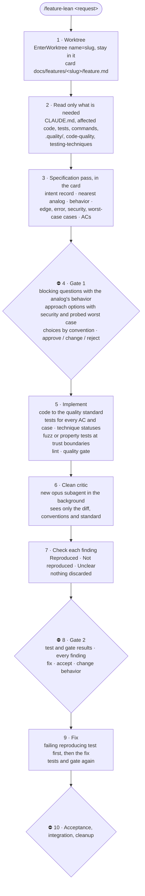

# `/feature-lean`: how the lean pipeline works

`/feature-lean` is the main mode of this repository. One Claude Code session takes one feature from request to integration. It keeps the pieces of the full workflow that showed value in the experiments, at about a third of the cost:
- a specification pass that enumerates edge, error, security and worst-case behavior, each compared with the project's nearest existing analog;
- your answers before any code;
- code and tests to the quality standard;
- one review by a clean critic that never saw the code being written.

The behavior is defined by [`skills/feature-lean/SKILL.md`](../skills/feature-lean/SKILL.md). This document explains it; when the two disagree, the skill file wins.

## When to use it, and when not

| Use `/feature-lean` when | Use `/feature` when |
| --- | --- |
| One feature, or several independent ones you can run as parallel sessions | Several features that must be coordinated in one portfolio, with overlap detection |
| Requirements are clear enough to settle at one gate | Requirements will evolve: ESDD increments, prototypes, a spec change log |
| You want control over behavior and approach, and a clean review, at a moderate cost | You want separate specification, planning, test-design, implementation and testing agents, or the R2 review cycle |
| You are on a plan with a usage limit | The token budget is not a concern |

`/feature-lean` never starts `/feature` itself. If the work outgrows it, it tells you once that `/feature` exists.

## The flow

The session does all the work itself. The only subagent is the critic. There is no orchestrator relaying messages, and that relay is where most of the full workflow's cost went: 46% of all tokens in the measured run.

## Step by step

### 1. Worktree and card

- **Worktree:** the session calls `EnterWorktree` with the feature's slug and **stays in it**: it is the one working there, not an orchestrator. It records the path, the branch and the base commit. If the worktree cannot be created, it stops and asks; it never falls back to the shared checkout.
- **Card:** the feature's only artifact is created from the template at `docs/features/<slug>/feature.md`, or the project's own docs convention. Its target is 500 lines, enough room for the plan and design decisions, and later the critic's `review.md` sits beside it. The card holds: The target is never a cut: when a feature needs more, the card stays as the summary and the overflow goes to `decisions/D-NNN-<topic>.md` or `feature-appendix.md`, linked by section, with the total size reported at the next gate.
  - intent and scope;
  - requirements and acceptance criteria;
  - decisions, with your answers and their dates;
  - plan;
  - state, used to resume;
  - result.

### 2. Reading, on a budget

The session reads only:
- the project's `CLAUDE.md`, the code of the affected area, its tests, and the build, test and lint commands;
- `.quality/`, if the project has one;
- `knowledge/code-quality.md`: smallest complete change, no comments, size limits as signals, names, single responsibility, existing style, surgical changes, test-first defect fixes;
- `knowledge/testing-techniques.md`;
- `knowledge/design-patterns.md`, only if a pattern is under consideration.

Nothing else from the library is loaded.

### 3. Specification pass

Written into the card before any code:
- **The intent record.** The request evolves as you talk, so the card keeps your original request verbatim, a consolidated intent you confirm at each gate, and your statements since, verbatim (S-1, S-2…), only those that change the intent. At each gate the session proposes a new consolidated version; once you confirm it, the absorbed statements move to an appendix, so the card does not grow with the conversation. The rest of the pass is the current reading of that record, not a closed contract: where they diverge, your words win.
- **Reach of the intent:** for each broad statement ("everywhere that…", "all…", "consistently"), the search run and the places found so far, including subclasses, overrides and copies of the same list.
- **Outside the intent:** what a reader might assume is included, marked as the session's reading, for you to confirm at gate 1.
- **Nearest analog:** the existing feature of the project most like this one, with its `path:line`, and how it handles each case: empty and invalid input, whitespace, exceptions raised by user-supplied objects, escaping and safe-marking, error messages. If there is none, the card says so.
- **Behavior:** testable statements, each traced to the request or to code evidence.
- **Edge and error cases** for every input, each with the analog's behavior as a fact:
  - boundaries, empty and missing values;
  - invalid values and encodings;
  - error paths;
  - duplicates and ordering;
  - concurrency.
- **Security:** escaping, injection, safe-marking, authorization and trust boundaries.
- **Worst case:** the costliest input size or shape, and the expected bound.
- **Acceptance criteria**, in Given/When/Then form.

### 4. Gate 1: behavior and approach

One message, with every item shown in full:
- **Blocking questions.** A question is blocking when its answer changes the output for a valid input. Each one comes with why it matters, its options, and what the analog does. The analog is a fact, not a recommendation: an option that follows it and one that departs from it are presented alike.
- **Approach.** If more than one approach is viable, the options appear in the neutral format, each with its **security consequence** and its **worst case**.
  - **Probes:** for parsers, regular expressions, escaping or safe-marking, the session runs a quick probe before the gate: a timing loop that doubles the input, and an injection string. The worst case it reports is measured, not guessed.
  - **Single approach:** if only one approach is viable, it is stated with the excluded alternatives and the constraint each violates.
- **Choices by convention:** small implementation details settled by following the project's conventions, one line each, so you can override any of them.
- **Specialists:** the session lists, as facts, the specialists whose signals match: security, UI/UX, database, network, performance, observability, or your own. You choose which run and in which slots. `security` always runs on a Critical feature it matches. If you choose `spec` or `plan` slots, their questions and facts come in a short **gate 1b** before any code.
- **Criticality:** Critical or Standard. Critical makes mutation testing mandatory. For Standard, you decide whether to run it. If no mutation tool is installed, you choose between installing one and leaving mutation testing *Blocked*, with its residual risk.
- **Approval:** approve, change (what), or reject.

Example from the measured run, on the `` template tag:

> **Q2.** `==` raises between `expr` and a case value (e.g. `__eq__` raises `ValueError`). What happens?
> Analog: `` catches `Exception` and treats the comparison as False (probe rendered the else branch).
> - **A: treat as no match and continue.** Security: none; a bug in user code is hidden. Worst case: same cost per value.
> - **B: propagate.** The render fails with the original exception. Security: none. Worst case: same.

### 5. Implementation and tests

- **Production code:** follows the quality standard. It stays within the approved scope, matches the existing style, removes only what this change left unused, and mentions pre-existing dead code instead of deleting it.
- **Tests:** in Lean the same session writes them, because there is no separate tester. They cover:
  - every acceptance criterion and every edge, error, security and worst-case item;
  - each technique from `knowledge/testing-techniques.md`, recorded in the card as *Applied* or *Not applicable* with its reason: Boundary Value Analysis, Fuzz/property-based, Decision Table, Finite State Machine, Symbolic/Concolic;
  - fuzz or property tests on every input that crosses a trust boundary or receives user-supplied objects, including objects whose comparison, conversion or iteration raises;
  - an end-to-end test through the real entry point, when the feature is user-facing and the project has a harness. Without a harness, the card notes it, and nothing is installed without your approval.
- **Mutation testing,** when the feature is Critical or you chose it. Once the tests pass, the session mutates the changed code with the project's tool (mutmut or cosmic-ray, Stryker, PIT, cargo-mutants…). It classifies each surviving mutant as a test gap, equivalent or out of scope, strengthens the tests for the gaps, and reports the score and the survivors at gate 2.
- **Checks:** the tests, the project's lint and type checks, and `scripts/quality_gate.py`. The session fixes what it wrote.
- **Discoveries:** a discovery that changes approved behavior becomes a new question to you.

### 6. The clean critic, and the specialist audits you chose

- **Launch:** one new subagent (`general-purpose`, Opus), in the background. Its brief has only the worktree, the branch, the base commit, its role file and the output path. It gets no summary of the feature, no card and no conversation, and it is told not to open the feature folder.
- **Review:** it reviews `git diff <base>` from scratch against the quality standard and the project's conventions, and writes `review.md`.
- **Specialist auditors:** each one chosen in its `audit` slot is a new clean agent, in parallel with the critic. Each writes `<name>.md` beside the card with executed evidence: an exploit (security), a query plan (database), a timing table (performance), screenshots and an accessibility scan (UI/UX), a stubbed failure (network), captured logs (observability). A finding without evidence is a *Possible risk*.
- **Why a separate agent:** a model reviewing its own output misses more problems than a fresh one, per the self-attribution research cited in [`references.md`](references.md).

### 7. Checking the findings

The session checks every finding of the critic and the specialists against the code, re-running their evidence, merges duplicates, and marks it **Reproduced** (with evidence), **Not reproduced** (with what it tried) or **Unclear**. Nothing is discarded: you see every finding.

### 8. Gate 2: findings and results

One message:
- **Results:** the test commands and their real output, and the quality gate's result.
- **Findings:** every finding with its severity, its concrete case and the session's check. Each one offers fix, accept as a known limitation, or change the behavior. Accepting a reproduced Blocker requires your stated reason, which is recorded and repeated at acceptance.
- **Open items:** anything the session could not settle.

### 9. Fixes

- **Test first:** for each behavior-changing Blocker or Major you chose to fix, the session first writes a test that reproduces it, runs it and sees it fail, then fixes the code and sees it pass. Both runs are reported.
- **Re-check:** the tests and the gate run again.
- **Second critic:** runs only if you ask. It is a new agent that reviews only the fixes.

### 10. Acceptance, integration and cleanup

- **Card:** the session writes the card's *Result*: files changed, test commands with real results, testing-technique statuses, gate result, `shortcut:` markers, known limitations, accepted findings.
- **Acceptance:** you decide.
- **Integration:** presented neutrally (merge, rebase then merge, pull request, or leave the branch unmerged), with the facts: uncommitted changes, commits ahead and behind, and files also changed on the target.
- **Cleanup:** then you decide whether to remove the worktree and branch. The work is committed only as part of the integration you choose.

## Several features, resuming, and what persists

- **Parallel features:** one session per feature. Each runs in its own worktree, so sessions do not interfere. There is no portfolio board or overlap detection: if two features touch the same files, you find out at integration.
- **Resume:** `/feature-lean resume <slug>` in a new session finds `.claude/worktrees/<slug>`, enters it, reads the card and continues from its *State*.
- **What lives on disk:** the code on the feature branch, `feature.md` and `review.md`. Everything you decided is in the card.

## Cost and evidence

Measured on Django 6.1, with 3 large features (a `` tag, a `ColorField` and a `naturalduration` filter), each run once with a simulated programmer:

| | Plain session | `/feature-lean` v1 | `/feature-lean` v2 (analog + techniques) | `/feature` High |
| --- | --- | --- | --- | --- |
| Cost | USD 1.12 | USD 5.30 | USD 5.64 | USD 15.16 |
| × plain session | 1 | 4.7 | 5.0 | 13.5 |
| Hidden tests | 41/43 | 42/43 | 42/43 | 42/43 |
| Turns with the programmer | — | 4 per feature | 4 per feature | 13 |
| Wall time | — | ~9 min, in parallel | ~10 min, in parallel | hours |

- **Questions surfaced:** in v2, the two behaviors that v1 missed (an exception from a user object inside ``, and surrounding whitespace in `ColorField`) reached gate 1 as explicit questions, with the analog's behavior attached. The simulated programmer chose differently from the analog both times, so the remaining hidden-test miss came from a decision, not an oversight.
- **Real feature, maintainers' tests:** on Django's HTTP QUERY method, Lean passed 47/48 of the maintainers' tests for USD 2.61 (5× a plain session), with no regressions. The miss, `RedirectView` without a `query()` handler, is what the reach-of-the-intent step and the critic's intent check now look for. Details in [`cost-estimates.md`](cost-estimates.md).
- **Discoveries:** anything found after gate 1 that your words seem to reach is recorded in the card's *Discoveries* with its relation to the intent and goes to you, at once if it changes approved behavior, otherwise at gate 2.
- **Limits:** these figures are n=1, with hidden tests written by the workflow's designers and a simulated programmer. See [`cost-estimates.md`](cost-estimates.md) and the README's *Evidence so far*.

## What Lean does not do

- **No separate roles:** there is no separate specification, planning, test-design or testing agent. The same session that writes the code writes its tests. That is the main trade-off against `/feature`, where only the Tester writes tests and the cases come from a Test Designer who never sees the plan.
- **Review:** there is no verifier, no automatic fixes and no multi-round cycle. You decide every finding, including the specialists'.
- **Testing depth:** mutation testing runs only for Critical features or when you choose it. There are no ESDD increments or prototypes.
- **Coordination:** there is no portfolio, no claims and no overlap detection across sessions.
- **Registry:** no anti-pattern registry bootstrap. If `.quality/` exists, Lean reads and respects it, but does not create or extend it.
