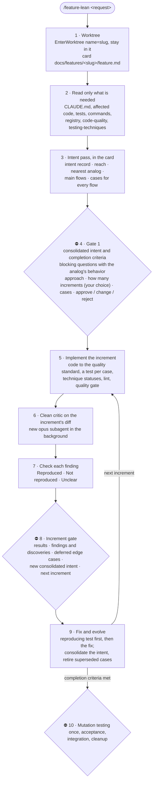

# `/feature-lean`: how the lean pipeline works

`/feature-lean` is the main mode of this repository. One Claude Code session takes one feature from request to integration. It keeps the pieces of the full workflow that showed value in the experiments, at about a third of the cost:
- an intent record of your own words, consolidated with you at each gate;
- increments, main flows first, each with its edge, error, security and worst-case cases compared with the project's nearest existing analog and settled with you before its code;
- code and tests to the quality standard;
- a review of each increment by a clean critic that never saw the code being written.

The behavior is defined by [`skills/feature-lean/SKILL.md`](../skills/feature-lean/SKILL.md). This document explains it; when the two disagree, the skill file wins.

## When to use it, and when not

| Use `/feature-lean` when | Use `/feature` when |
| --- | --- |
| One feature, or several independent ones you can run as parallel sessions | Several features that must be coordinated in one portfolio, with overlap detection |
| Requirements can be settled with you increment by increment | The approach itself needs exploration with a separate Planner and disposable prototypes |
| You want control over behavior and approach, and a clean review, at a moderate cost | You want separate specification, planning, test-design, implementation and testing agents, or the R2 review cycle |
| You are on a plan with a usage limit | The token budget is not a concern |

`/feature-lean` never starts `/feature` itself. If the work outgrows it, it tells you once that `/feature` exists.

## The flow

The session does all the work itself. The only subagents are the critics, one per increment. There is no orchestrator relaying messages, and that relay is where most of the full workflow's cost went: 46% of all tokens in the measured run.

**Increments, if you want them.** Lean follows `workflows/evolutionary.md` without its separate agents. There is no specification: the card's intent record, its decisions and its cases say what the feature must do. At gate 1 you choose how to deliver it: one increment for the whole feature (one critic and one increment gate, the one-pass flow Lean had before), one per main flow (a critic and a gate per flow), or another grouping. At each increment gate you can regroup what remains.

## Step by step

### 1. Worktree and card

The session calls `EnterWorktree` with the feature's slug and stays in it. It records the path, branch and base commit, and creates the card from `templates/feature-card.md`. The card's target is 500 lines; when a feature needs more, the overflow goes to linked files next to it (`decisions/`, `feature-appendix.md`), never cut.

### 2. Reading, on a budget

Only what the feature needs: CLAUDE.md, the affected code and its tests, the build, test and lint commands, the anti-pattern registry if the project has one, the code-quality standard, the testing techniques, two sections of the specification guide (what the reading of your intent is, and discoveries), the opening of the evolutionary workflow, and the frontmatter of the specialists. Nothing else from the library.

### 3. Intent pass

Written into the card before any code:
- **The intent record.** The request evolves as you talk, so the card keeps your original request verbatim, a consolidated intent you confirm at each gate (with the completion criteria: what "done" means for you), and your statements since, verbatim (S-1, S-2…), only those that change the intent. At each gate the session proposes a new consolidated version; once you confirm it, the absorbed statements move to an appendix, so the card does not grow with the conversation.
- **Scope:** for each broad statement ("everywhere that…", "all…", "consistently"), the search run and the places found so far, including subclasses, overrides and copies of the same list. And what a reader might assume is included, marked as the session's reading, for you to confirm.
- **Nearest analog:** the existing feature of the project most like this one, with its `path:line`, and how it handles empty and invalid input, whitespace, exceptions from user objects, escaping and error messages.
- **Main flows:** the feature's main flows, in order, as the possible split into increments.
- **Cases** for every main flow: every case with its expected result, its source (your request, a statement, a decision, or existing behavior with `path:line`) and what the analog does: boundaries, empty and missing values, invalid values and encodings, error paths, duplicates and ordering, concurrency, security (escaping, injection, safe-marking, authorization), and the worst-case input. Cases of later flows may be revised when their increment starts.

### 4. Gate 1: intent, approach and first increment

One message, every item in full:
- the consolidated intent and completion criteria, and the readings to confirm;
- blocking questions, each with what the analog does as a fact, never as a recommendation; questions that only later increments need wait for them;
- the approach: options in the neutral format, each with its security consequence and its worst case (probed for parsers, regular expressions, escaping or safe-marking);
- how many increments, as a neutral question (one for the whole feature, one per main flow, or your own grouping), with the cases in full; an edge case you want to defer needs your decision naming the increment that will cover it;
- choices by convention, one line each, which you may override;
- the specialists whose signals match, as facts, and which of them run;
- criticality: Critical makes mutation testing mandatory, once at the end; for a Standard feature, a neutral question;
- approve, change or reject.

### 5. Implementation and tests, per increment

The session writes the increment's code to the quality standard and a test for every one of its cases. Each testing technique gets a status for the increment; inputs that cross a trust boundary get fuzz or property-based tests; a user-facing flow gets an end-to-end test when the project has a harness. Then lint, type checks and the quality gate. Anything found that the gates did not settle goes to the card's *Discoveries*; only one that blocks the work is asked at once.

### 6. The clean critic, per increment, and the specialist audits you chose

A new opus subagent, in the background, reviews the increment's diff from the commit where it started. It sees only that diff, the code it touches, the project's conventions, the quality standard and your own words (original request, confirmed consolidated intent, statements since). It never sees the card or how the code was written. The specialist auditors you chose run alongside it under the same rules. None is ever resumed.

### 7. Checking the findings

The session checks every finding against the code and re-runs each specialist's evidence: *Reproduced*, *Not reproduced* or *Unclear*. Nothing is discarded.

### 8. Increment gate

The only gate of the increment: test and gate results; every finding and discovery with its relation to your words, and fix, accept or change behavior as options; the deferred edge cases still open; a new consolidated intent when you said something new; and the next increment's flow and cases, or the move to acceptance when the completion criteria are met. You can also regroup the remaining increments.

### 9. Fix and evolve

A defect that changes behavior is fixed test-first: a test that reproduces it fails, then the fix makes it pass. A specialist's fixed finding gets a new auditor on the fix diff. A second critic on the fixes runs only if you ask. Then the intent is consolidated if you confirmed a new version, cases whose source statement you superseded are retired, and the next increment starts.

### 10. Mutation testing, acceptance, integration and cleanup

When the feature is Critical or you chose it, mutation testing runs once, over all the changed code, and its survivors are classified and the test gaps closed. The card's *Result* records each increment's results, the technique statuses, the specialists, mutation testing, known limitations, accepted findings and any deferred edge case never covered. You decide acceptance, how the branch is integrated, and whether the worktree is removed.

## Several features, resuming, and what persists

- **Parallel features:** one session per feature. Each runs in its own worktree, so sessions do not interfere. There is no portfolio board or overlap detection: if two features touch the same files, you find out at integration.
- **Resume:** `/feature-lean resume <slug>` in a new session finds `.claude/worktrees/<slug>`, enters it, reads the card and continues from its *State*.
- **What lives on disk:** the code on the feature branch, `feature.md` and one `review-<increment>.md` per increment. Everything you decided is in the card.

## Cost and evidence

Measured on Django 6.1, with 3 large features (a `` tag, a `ColorField` and a `naturalduration` filter), each run once with a simulated programmer:

| | Plain session | `/feature-lean` v1 | `/feature-lean` v2 (analog + techniques) | `/feature` High |
| --- | --- | --- | --- | --- |
| Cost | USD 1.12 | USD 5.30 | USD 5.64 | USD 15.16 |
| × plain session | 1 | 4.7 | 5.0 | 13.5 |
| Hidden tests | 41/43 | 42/43 | 42/43 | 42/43 |
| Turns with the programmer | — | 4 per feature | 4 per feature | 13 |
| Wall time | — | ~9 min, in parallel | ~10 min, in parallel | hours |

- **Questions surfaced:** in v2, the two behaviors that v1 missed (an exception from a user object inside ``, and surrounding whitespace in `ColorField`) reached gate 1 as explicit questions, with the analog's behavior attached. The simulated programmer chose differently from the analog both times, so the remaining hidden-test miss came from a decision, not an oversight.
- **Real feature, maintainers' tests:** on Django's HTTP QUERY method, Lean passed 47/48 of the maintainers' tests for USD 2.61 (5× a plain session), with no regressions. The miss, `RedirectView` without a `query()` handler, is what the reach-of-the-intent step and the critic's intent check now look for. Details in [`cost-estimates.md`](cost-estimates.md).
- **Discoveries:** anything found after gate 1 that your words seem to reach is recorded in the card's *Discoveries* with its relation to the intent and goes to you, at once if it blocks the work, otherwise at the increment gate.
- **Measured before increments:** every figure above comes from the one-pass Lean, which is the single-increment choice. Each extra increment adds a critic and a gate.
- **Limits:** these figures are n=1, with hidden tests written by the workflow's designers and a simulated programmer. See [`cost-estimates.md`](cost-estimates.md) and the README's *Evidence so far*.

## What Lean does not do

- **No separate roles:** there is no separate specification, planning, test-design or testing agent. The same session that writes the code writes its tests. That is the main trade-off against `/feature`, where only the Tester writes tests and the cases come from a Test Designer who never sees the plan.
- **Review:** there is no verifier, no automatic fixes and no multi-round cycle. You decide every finding, including the specialists'.
- **Testing depth:** mutation testing runs once at the end, only for Critical features or when you choose it. There are no disposable prototypes.
- **Coordination:** there is no portfolio, no claims and no overlap detection across sessions.
- **Registry:** no anti-pattern registry bootstrap. If `.quality/` exists, Lean reads and respects it, but does not create or extend it.
